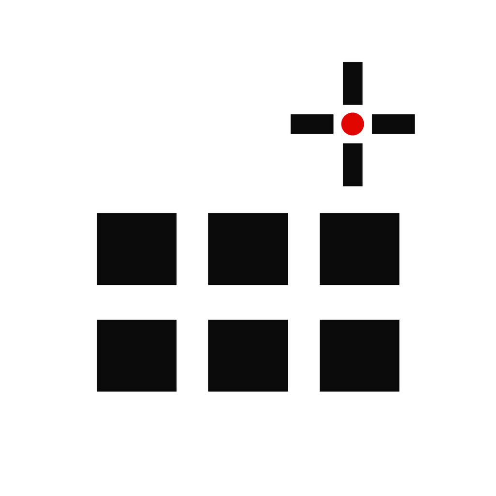
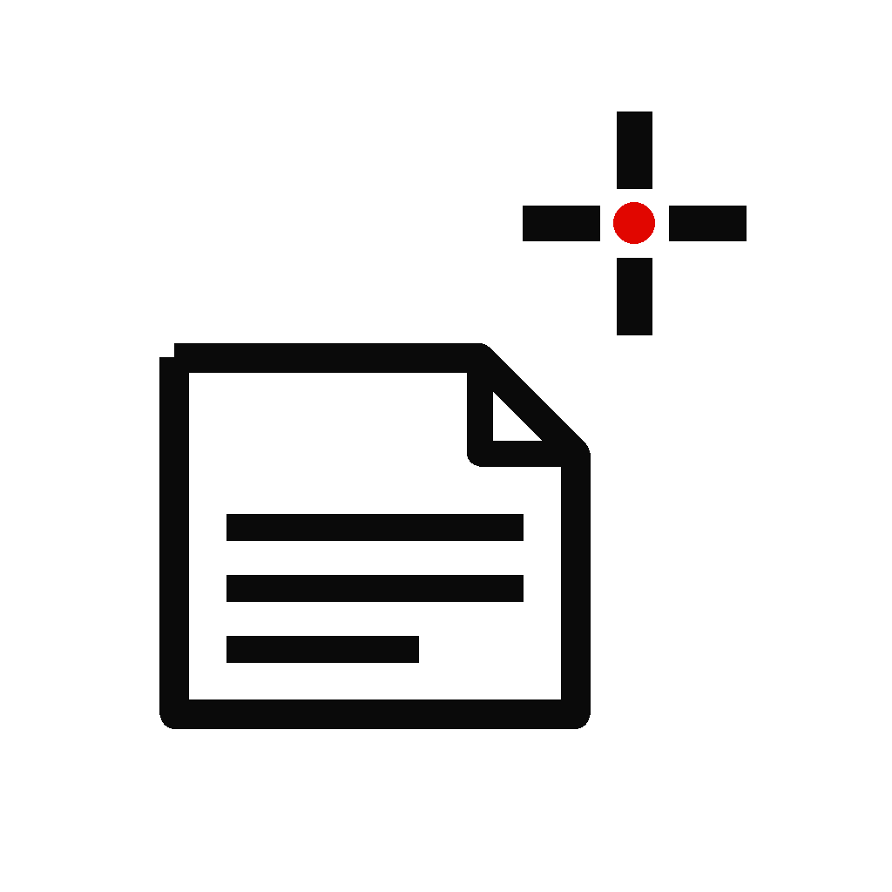
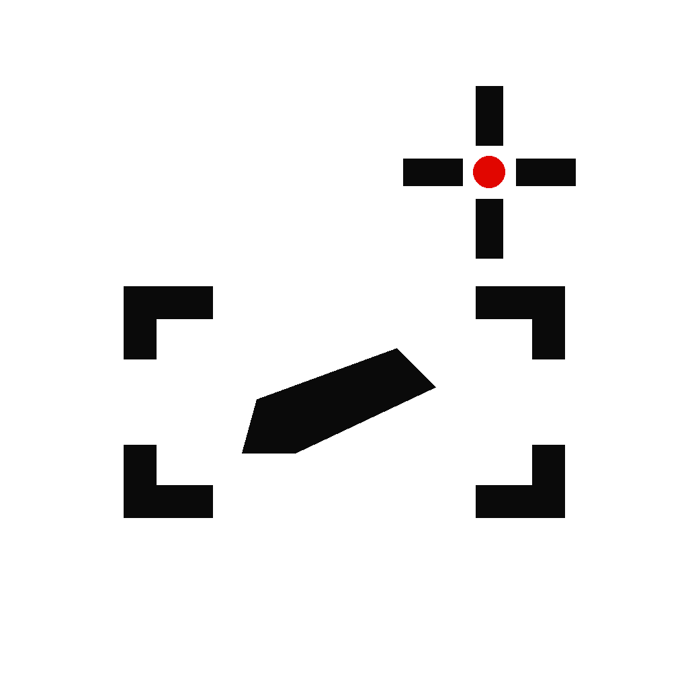

Erwin Blom is onderzoeker, maker, bouwer en aanjager. Hij onderzoekt wat er speelt, maakt wat bruikbaar is en brengt mensen in beweging. Hij bouwt apps, tools, platforms en communities. Via nieuwsbrieven, boeken en cursussen helpt hij mensen om zelf aan de slag te gaan. Hij is momenteel vooral gefascineerd door de mogelijkheden en onmogelijkheden van AI. 

## Waarom ik dit deel

Ik ben geen programmeur en geen designer. Met AI maak ik tools en skills die ik zelf nodig heb. Ik deel ze om te laten zien wat er nu mogelijk is, je enthousiast te maken en je op gang te helpen.

Gebruik wat je kunt gebruiken, bouw erop voort en maak het passend bij jouw werk, smaak en wensen. Ik hoop vooral dat je denkt: dat kan ik ook proberen.

## FMT / APPS

Ik bouw wat ik zelf nodig heb. Deze apps kun je gebruiken als vertrekpunt en met of zonder AI aanpassen aan je eigen werk.

| Icoon | App | Wat je ermee kunt |
|---|---|---|
|  | **[Werkplaats](https://github.com/erwinblom/werkplaats)** | Je lokale werkomgeving voor projecten, documenten, notities en praktische tools. |
|  | **[Tools voor Teksten](https://github.com/erwinblom/tools-voor-teksten)** | Documenten omzetten naar Markdown, persoonsgegevens afschermen, metadata controleren, documenten samenvoegen en versies vergelijken. |
|  | **[Kladblok](https://github.com/erwinblom/kladblok)** | Snel schrijven of plakken in je browser. Je klad blijft lokaal bewaard; download het als tekst of Markdown. |
|  | **[Video Editor](https://github.com/erwinblom/fmt-video-editor)** | Interviews knippen, ordenen, ondertitelen en als video exporteren. |
|  | **[Screenshot Editor](https://github.com/erwinblom/screenshot-editor)** | Screenshots en tekstkaarten opmaken, voorzien van je eigen stijl en bewaren als PNG. |

Screenshot Editor, Video Editor en Kladblok zijn beschikbaar voor Mac, Windows en Linux. Kladblok en de basis van Screenshot Editor open je rechtstreeks in je browser. Video Editor gebruikt een lokale server en vraagt installatie van enkele hulpmiddelen. Bij iedere tool staan de startstappen, downloads en geteste platformen.

### Bekijk de tools

##  [Werkplaats](https://github.com/erwinblom/werkplaats)

je eigen werkplek voor ideeën, teksten en projecten. Verzamel bronnen, schrijf documenten en houd overzicht over je werk. [Open Werkplaats](https://erwinblom.github.io/werkplaats/) of [download voor offline gebruik](https://github.com/erwinblom/werkplaats/releases/latest/download/Werkplaats.zip).

##  [Tools voor Teksten](https://github.com/erwinblom/tools-voor-teksten)

jouw informatie in bruikbare bestanden, onder jouw controle. [Gebruik online](https://tools-voor-teksten-fmt.erwinblom.chatgpt.site/) of [download voor Mac met Apple Silicon](https://github.com/erwinblom/tools-voor-teksten/releases/latest).

##  [Kladblok](https://github.com/erwinblom/kladblok)

één plek om snel iets op te schrijven en als tekst of Markdown mee te nemen.

##  [Video Editor](https://github.com/erwinblom/fmt-video-editor)

importeer een opname, monteer fragmenten, voeg ondertitels toe en maak een video en thumbnail.

*Video Editor toont een praktijkvoorbeeld uit mijn eigen editor; het interview wordt niet meegeleverd. De platformuitgave is een proefversie. Bij elke tool staan de precieze testresultaten en beperkingen.*

##  [Screenshot Editor](https://github.com/erwinblom/screenshot-editor)

maak een screenshot of tekstkaart, kies je opmaak en bewaar het beeld als PNG.

## Zo pas je deze tools aan met AI

Begin met één kleine wens: grotere letters, een andere kleur of een extra knop. Je hoeft daarvoor geen programmeur te zijn.

1. Download het volledige bronpakket bij de tool. Pak het uit en maak een kopie om in te werken.
2. Open die kopie in Codex, Claude Code of een andere AI-omgeving die lokale bestanden kan aanpassen. In een gewone chat voeg je het bronpakket toe; die chat kan niet vanzelf je computerbestanden wijzigen.
3. Beschrijf één wijziging, wat moet blijven werken en of je Mac, Windows of Linux gebruikt.
4. Laat de AI helpen starten. Controleer je wijziging én iets maken, bewaren, sluiten en opnieuw openen.

Kopieer bijvoorbeeld deze opdracht:

> Ik ben geen programmeur en gebruik [Mac, Windows of Linux]. Lees de handleiding en de code van deze tool. Mijn eerste wens is: [één concrete wijziging]. Werk in een kopie. Behoud bestaande functies, mijn gegevens en licenties. Pas de bestanden aan als je dat kunt; lever anders het complete gewijzigde project als download. Help me starten en controleer bewaren en opnieuw openen. Vertel wat je echt hebt getest. Publiceer of verstuur niets.

Werkt de download niet? Vraag bij een kleine wijziging om de exacte bestandsnaam en welke tekst je moet zoeken en vervangen. Deel geen wachtwoorden, sleutels of privébestanden. Je gekozen AI-omgeving kan betaald zijn.

Bij iedere tool staan passende voorbeelden en startstappen.

## FMT / SCHRIJVEN EN SKILLS

| Product | Wat je ermee kunt |
|---|---|
| **[Schrijftafel](https://github.com/erwinblom/schrijftafel)** | Lokaal schrijven en je Markdown-teksten beheren, met een opgemaakte editor. |
| **[Tekstploeg](https://github.com/erwinblom/open-ai-skills-nl/tree/main/skills/tekstploeg)** | Negen AI-skills voor onderzoeken, schrijven en redigeren. |
| **[Innovatieploeg](https://github.com/erwinblom/open-ai-skills-nl/tree/main/skills/innovatieploeg)** | Vijf AI-skills om ideeën uit te werken, aannames te testen en bewijs te wegen. |

Werkplaats en Schrijftafel werken met je eigen bestanden. Tekstploeg en Innovatieploeg gebruik je in een AI-omgeving die skills ondersteunt. De gekoppelde repositories zijn open source.

## FMT / NIEUWSBRIEF

- [FMT Handpicked](https://handpicked.fastmovingtargets.nl) — media, technologie en innovatie.

## FMT / OVER MIJ

Journalist van oorsprong. Sinds 1994 actief in internet, media en innovatie.

[Fast Moving Targets](https://www.fastmovingtargets.nl) · [LinkedIn](https://www.linkedin.com/in/erwinblom/)
