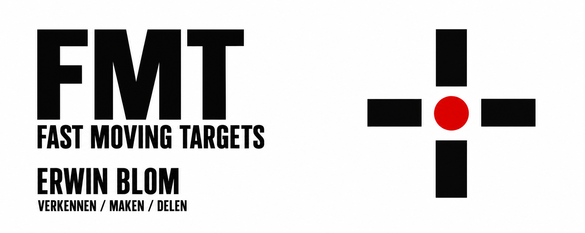

Erwin Blom is onderzoeker, maker, bouwer en aanjager. Hij onderzoekt wat er speelt, maakt wat bruikbaar is en brengt mensen in beweging. Hij bouwt apps, tools, platforms en communities. Via nieuwsbrieven, boeken en cursussen helpt hij mensen om zelf aan de slag te gaan. Hij is momenteel vooral gefascineerd door de mogelijkheden en onmogelijkheden van AI. 

## Waarom ik dit deel

Ik ben geen programmeur en geen designer. Met AI maak ik tools en skills die ik zelf nodig heb. Ik deel ze om te laten zien wat er nu mogelijk is, je enthousiast te maken en je op gang te helpen.

Gebruik wat je kunt gebruiken, bouw erop voort en maak het passend bij jouw werk, smaak en wensen. Ik hoop vooral dat je denkt: dat kan ik ook proberen.

## FMT / APPS

Ik bouw wat ik zelf nodig heb. Deze apps kun je gebruiken als vertrekpunt en met of zonder AI aanpassen aan je eigen werk.

| App | Wat je ermee kunt |
|---|---|
| **[Werkplaats](https://github.com/erwinblom/werkplaats)** | Je lokale werkomgeving voor projecten, documenten, notities en praktische tools. |
| **[Screenshot Editor](https://github.com/erwinblom/screenshot-editor)** | Screenshots en tekstkaarten opmaken, voorzien van je eigen stijl en bewaren als PNG. |
| **[Video Editor](https://github.com/erwinblom/fmt-video-editor)** | Interviews knippen, ordenen, ondertitelen en als video exporteren. |
| **[Kladblok](https://github.com/erwinblom/kladblok)** | Snel iets schrijven of plakken vanuit de Mac-menubalk. Je klad blijft lokaal bewaard en kan als tekstbestand worden opgeslagen. |

Screenshot Editor, Video Editor en Kladblok zijn voor macOS. De bronuitgaven bouw of installeer je zelf; de handleidingen helpen je op weg.

## FMT / SCHRIJVEN EN SKILLS

| Product | Wat je ermee kunt |
|---|---|
| **[Schrijftafel](https://github.com/erwinblom/schrijftafel)** | Lokaal schrijven en je Markdown-teksten beheren, met een opgemaakte editor. |
| **[Tekstploeg](https://github.com/erwinblom/open-ai-skills-nl/tree/main/skills/tekstploeg)** | Negen AI-skills voor onderzoeken, schrijven en redigeren. |
| **[Innovatieploeg](https://github.com/erwinblom/open-ai-skills-nl/tree/main/skills/innovatieploeg)** | Vijf AI-skills om ideeën uit te werken, aannames te testen en bewijs te wegen. |

Werkplaats en Schrijftafel werken met je eigen bestanden. Tekstploeg en Innovatieploeg gebruik je in een AI-omgeving die skills ondersteunt. De gekoppelde repositories zijn open source.

## FMT / NIEUWSBRIEF

- [FMT Handpicked](https://handpicked.fastmovingtargets.nl) — media, communicatie en innovatie.

## FMT / OVER MIJ

Journalist van oorsprong. Sinds 1994 actief in internet, media en innovatie.

[Fast Moving Targets](https://www.fastmovingtargets.nl) · [LinkedIn](https://www.linkedin.com/in/erwinblom/)
